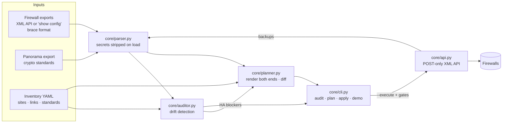

# corp-s2s

Audit, plan and apply **PAN-OS site-to-site IPsec tunnels** across a multi-site estate of Palo Alto Networks
firewalls (HA pairs and standalone cloud firewalls), with crypto standards managed in Panorama.

It was built for a real environment of 46 firewalls and about 160 internal tunnel pairs. This repository ships
**only the engine and fictional demo data**. Production exports, inventories, backups and pre-shared keys
never enter version control (see [Data handling](#data-handling)).

```bash
python3 vpn_manager.py demo        # audit -> plan -> dry-run apply on fictional data; sends nothing
```

---

## Why

In a hand-built VPN mesh, both ends of every tunnel are configured separately, so the two halves drift apart:

| Drift class | What goes wrong |
|---|---|
| Missing / mismatched crypto profile | One end falls back to PAN-OS `default` (3DES/SHA1/DH2) and Phase 2 never forms |
| Local profile shadowing a Panorama standard | A local copy with DH14 silently overrides the template's DH20 and breaks every tunnel on that device |
| Copy-pasted proxy-IDs | A tunnel advertises another site's subnet, so those SAs never match |
| ISP swap | One end builds from ISP1 while the far end expects ISP2 |
| HA drift | The passive member lacks tunnels the active one has, so failover drops sites |
| Reused tunnel /30s, one-sided gateways | Monitoring becomes ambiguous; stale config is left behind |

`corp-s2s` fixes the root cause: **a link is defined once, and both ends are generated from the same data.**

## Architecture



| Module | Responsibility |
|---|---|
| `core/parser.py` | Parses XML and brace-format exports into typed dataclasses (interfaces, zones, VRs, routes, IKE/IPsec profiles, gateways, tunnels, HA). Strips every secret leaf as soon as a file loads. |
| `core/auditor.py` | Pairs every tunnel with its mirror on the far end. Checks crypto compliance, gateway/ISP symmetry, proxy-ID symmetry, tunnel IP/unit collisions, HA sync and link coverage. |
| `core/planner.py` | Turns inventory links into per-device actions in dependency order (tunnel interface → zone → VR → IKE gateway → IPsec tunnel → routes). Diffs them against current state. Never deletes. |
| `core/api.py` | PAN-OS XML API client: POST only, key in the `X-PAN-KEY` header, read-only by default, dry-run journal, backups, commit job polling, typed errors. |
| `core/cli.py` | One command that ties it all together and enforces the apply gates. |
| `core/miniyaml.py` / `core/xpath.py` | Stdlib YAML-subset loader (PyYAML is used if installed) and safe xpath construction. |

**Panorama + XML API split.** Global crypto standards (IKE/IPsec profiles, tunnel-monitor profile) live in
Panorama templates, and the planner only references them by name. Per-link objects are device-specific, so
they are pushed straight to each firewall through the XML API. That's where they already live in most
brownfield estates, so adopting the tool needs no migration.

## Usage

Requires Python 3.9+ and `requests`. PyYAML is optional.

```bash
python3 vpn_manager.py demo                       # full walk-through on fictional data
python3 vpn_manager.py audit --demo               # drift report (exit 2 = errors, 1 = drift/warnings)
python3 vpn_manager.py plan  --demo --xml         # per-device changes, with xpath + redacted XML
python3 vpn_manager.py apply --demo               # the exact API calls --execute would make

# real estate (files stay in git-ignored folders)
python3 vpn_manager.py audit --exports exports/ --panorama exports/panorama.xml
python3 vpn_manager.py plan  --inventory inventory/sites.yaml --exports exports/
python3 vpn_manager.py apply --inventory inventory/sites.yaml --exports exports/ --device SITE-FW-01 --execute
```

Or install the `corp-s2s` command into a virtualenv: `python3 -m venv .venv && .venv/bin/pip install -e .`

### Demo output (abridged)

```
### 1/3 audit
  ERROR 5   DRIFT 0   WARNING 2   INFO 4
[ERROR] crypto/CRYPTO_LOCAL_SHADOW  AZ-CENTRAL-FW-01, AZ-CENTRAL-FW-02
    Local IPsec profile 'STD-IPSEC-AES256-SHA512-DH20' overrides the Panorama standard with different parameters
      - PFS/DH group differs: group14 vs group20
[ERROR] gateway/GW_ISP_SWAP  AZ-CENTRAL <-> OFC-BER
      - inventory link says OFC-BER should use isp1, so fix AZ-CENTRAL-FW-01
[ERROR] ha/HA_OUT_OF_SYNC  OFC-AUS
...
### 2/3 plan
  +63 create   ~3 update   191 unchanged   across 6 device(s)
== AZ-CENTRAL-FW-01
   ~ update ike-gateway      AZ-CENTRAL-OFC-BER
        peer_id: 198.51.100.50 -> 192.0.2.50
== OFC-AUS-FW-01
   BLOCKED: HA members out of sync
...
### 3/3 apply (dry run)
--- OFC-BER-FW-01: 8 API call(s) that --execute would send
    set    /config/devices/entry[@name='localhost.localdomain']/network/ike/gateway/entry[@name='OFC-BER-DC-EAST.Failover']
           <authentication><pre-shared-key><key>&lt;redacted&gt;</key>...
```

The demo inventory seeds seven drift scenarios (D1–D7), and the test suite checks that each one is reported
exactly once.

## Safety model

`apply --execute` contacts live devices only after every gate passes, checked per device:

1. The device is named explicitly with `--device` (there's no fleet-wide apply), and `--demo` data is refused.
2. The auditor reports no HA drift for the site.
3. The operator types the hostname to confirm.
4. Live pre-flight: the hostname matches, HA is synchronized, the active member is chosen, there are no foreign config/commit locks, and there are no pending changes.
5. A pre-change backup (`type=export`) is written to `backups/` with mode `0600`.
6. The backup is re-parsed and the plan recomputed. If the device changed since review, apply aborts.
7. Config lock → `set`/`edit` in dependency order → commit and wait for the job → release the lock. On any error, the candidate is reverted.
8. Post-commit HA sync check and IKE/IPsec SA verification.

API client guarantees: POST only; the key goes in a header and is never logged (a redacting log filter scrubs
keys, passwords and `-AQ==` encrypted strings). Reads are retried and writes never are. Unsafe xpaths and
malformed XML are rejected before sending. TLS verification is on by default.

## Inventory

A link is defined once. Each path is one tunnel, rendered on both ends:

```yaml
links:
  - a: DC-EAST
    b: OFC-AUS
    paths:
      - {role: primary,  a: isp1, b: isp1}
      - {role: failover, a: isp2, b: isp2}
```

Names follow `<LOCAL>-<REMOTE>[.Failover]`, routes use metric 10 for primaries and 12 for failovers, proxy-IDs
are LAN × LAN (mirrored), and new tunnel /30s are allocated deterministically from `standards.tunnel_ip_pool`.
See [`examples/mock_inventory.yaml`](examples/mock_inventory.yaml) for the full schema.

**PSKs** are never stored. Gateways are rendered with a `__PSK:<link-id>__` placeholder that is filled at
apply time from `PSK_<A>_<B>_<ROLE>` environment variables (or a prompt). Both ends of a link get the same key.

## Data handling

* Only code, docs and **fictional** data are tracked. The demo uses RFC 5737 addresses and `example.net`.
* `.gitignore` excludes exports (`*.xml`, `*.conf`), `inventory/`, `backups/`, `plans/`, `reports/`, `design/` and `.env*`.
* The parser removes secrets on load. Plan/JSON output and the API journal redact PSKs. Backups keep the device's
  own encrypted secrets so they can be restored, and are owner-only.

## Tests

```bash
python3 -m unittest discover -s tests -t .
```

44 offline tests: the API client against a fake transport (auth, locks, retries, commit jobs, backups, log
redaction), the seven demo drift scenarios, planner symmetry, allocation and idempotency, brace parsing, and
CLI gates, including a run that fails if anything touches the network.

## Status / roadmap

- [x] Parser (XML + brace), auditor, planner, API client, CLI with gated apply
- [ ] Panorama `commit-all` push for the standards layer
- [ ] Optional rendering as `set` commands, and per-site Panorama templates as an alternative target
- [ ] Prisma Access service connections / remote networks
