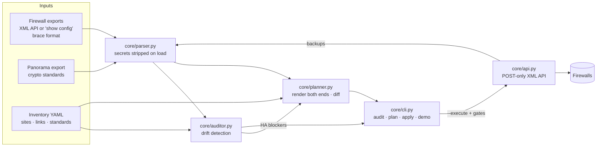

# corp-s2s

Audit, plan and apply **PAN-OS site-to-site IPsec tunnels** across a multi-site estate of Palo Alto Networks
firewalls (HA pairs and standalone cloud firewalls), with crypto standards managed in Panorama.

It was built for a real environment of 46 firewalls and about 160 internal tunnel pairs. This repository ships
**only the engine and fictional demo data**. Production exports, inventories, backups and pre-shared keys
never enter version control (see [Data handling](#data-handling)).

```bash
python3 vpn_manager.py demo        # audit -> plan -> dry-run apply on fictional data; sends nothing
```

---

## Why

In a hand-built VPN mesh, both ends of every tunnel are configured separately, so the two halves drift apart:

| Drift class | What goes wrong |
|---|---|
| Missing / mismatched crypto profile | One end falls back to PAN-OS `default` (3DES/SHA1/DH2) and Phase 2 never forms |
| Local profile shadowing a Panorama standard | A local copy with DH14 silently overrides the template's DH20 and breaks every tunnel on that device |
| Copy-pasted proxy-IDs | A tunnel advertises another site's subnet, so those SAs never match |
| ISP swap | One end builds from ISP1 while the far end expects ISP2 |
| HA drift | The passive member lacks tunnels the active one has, so failover drops sites |
| Reused tunnel /30s, one-sided gateways | Monitoring becomes ambiguous; stale config is left behind |

`corp-s2s` fixes the root cause: **a link is defined once, and both ends are generated from the same data.**

## Architecture



| Module | Responsibility |
|---|---|
| `core/parser.py` | Parses XML and brace-format exports into typed dataclasses (interfaces, zones, VRs, routes, IKE/IPsec profiles, gateways, tunnels, HA). Strips every secret leaf as soon as a file loads. |
| `core/auditor.py` | Pairs every tunnel with its mirror on the far end. Checks crypto compliance, gateway/ISP symmetry, proxy-ID symmetry, tunnel IP/unit collisions, HA sync and link coverage. |
| `core/planner.py` | Turns inventory links into per-device actions in dependency order (tunnel interface → zone → VR → IKE gateway → IPsec tunnel → routes). Diffs them against current state. Never deletes. |
| `core/api.py` | PAN-OS XML API client: POST only, key in the `X-PAN-KEY` header, read-only by default, dry-run journal, backups, commit job polling, typed errors. |
| `core/cli.py` | One command that ties it all together and enforces the apply gates. |
| `core/miniyaml.py` / `core/xpath.py` | Stdlib YAML-subset loader (PyYAML is used if installed) and safe xpath construction. |

**Panorama + XML API split.** Global crypto standards (IKE/IPsec profiles, tunnel-monitor profile) live in
Panorama templates, and the planner only references them by name. Per-link objects are device-specific, so
they are pushed straight to each firewall through the XML API. That's where they already live in most
brownfield estates, so adopting the tool needs no migration.

## Usage

Requires Python 3.9+ and `requests`. PyYAML is optional.

```bash
python3 vpn_manager.py demo                       # full walk-through on fictional data
python3 vpn_manager.py audit --demo               # drift report (exit 2 = errors, 1 = drift/warnings)
python3 vpn_manager.py plan  --demo --xml         # per-device changes, with xpath + redacted XML
python3 vpn_manager.py apply --demo               # the exact API calls --execute would make

# real estate (files stay in git-ignored folders)
python3 vpn_manager.py audit --exports exports/ --panorama exports/panorama.xml
python3 vpn_manager.py plan  --inventory inventory/sites.yaml --exports exports/
python3 vpn_manager.py apply --inventory inventory/sites.yaml --exports exports/ --device SITE-FW-01 --execute
```

Or install the `corp-s2s` command into a virtualenv: `python3 -m venv .venv && .venv/bin/pip install -e .`

### Demo output (abridged)

```
### 1/3 audit
  ERROR 5   DRIFT 0   WARNING 2   INFO 4
[ERROR] crypto/CRYPTO_LOCAL_SHADOW  AZ-CENTRAL-FW-01, AZ-CENTRAL-FW-02
    Local IPsec profile 'STD-IPSEC-AES256-SHA512-DH20' overrides the Panorama standard with different parameters
      - PFS/DH group differs: group14 vs group20
[ERROR] gateway/GW_ISP_SWAP  AZ-CENTRAL <-> OFC-BER
      - inventory link says OFC-BER should use isp1, so fix AZ-CENTRAL-FW-01
[ERROR] ha/HA_OUT_OF_SYNC  OFC-AUS
...
### 2/3 plan
  +63 create   ~3 update   191 unchanged   across 6 device(s)
== AZ-CENTRAL-FW-01
   ~ update ike-gateway      AZ-CENTRAL-OFC-BER
        peer_id: 198.51.100.50 -> 192.0.2.50
== OFC-AUS-FW-01
   BLOCKED: HA members out of sync
...
### 3/3 apply (dry run)
--- OFC-BER-FW-01: 8 API call(s) that --execute would send
    set    /config/devices/entry[@name='localhost.localdomain']/network/ike/gateway/entry[@name='OFC-BER-DC-EAST.Failover']
           <authentication><pre-shared-key><key>&lt;redacted&gt;</key>...
```

The demo inventory seeds seven drift scenarios (D1–D7), and the test suite checks that each one is reported
exactly once.

## Safety model

`apply --execute` contacts live devices only after every gate passes, checked per device:

1. The device is named explicitly with `--device` (there's no fleet-wide apply), and `--demo` data is refused.
2. The auditor reports no HA drift for the site.
3. The operator types the hostname to confirm.
4. Live pre-flight: the hostname matches, HA is synchronized, the active member is chosen, there are no foreign config/commit locks, and there are no pending changes.
5. A pre-change backup (`type=export`) is written to `backups/` with mode `0600`.
6. The backup is re-parsed and the plan recomputed. If the device changed since review, apply aborts.
7. Config lock → `set`/`edit` in dependency order → commit and wait for the job → release the lock. On any error, the candidate is reverted.
8. Post-commit HA sync check and IKE/IPsec SA verification.

API client guarantees: POST only; the key goes in a header and is never logged (a redacting log filter scrubs
keys, passwords and `-AQ==` encrypted strings). Reads are retried and writes never are. Unsafe xpaths and
malformed XML are rejected before sending. TLS verification is on by default.

## Inventory

A link is defined once. Each path is one tunnel, rendered on both ends:

```yaml
links:
  - a: DC-EAST
    b: OFC-AUS
    paths:
      - {role: primary,  a: isp1, b: isp1}
      - {role: failover, a: isp2, b: isp2}
```

Names follow `<LOCAL>-<REMOTE>[.Failover]`, routes use metric 10 for primaries and 12 for failovers, proxy-IDs
are LAN × LAN (mirrored), and new tunnel /30s are allocated deterministically from `standards.tunnel_ip_pool`.
See [`examples/mock_inventory.yaml`](examples/mock_inventory.yaml) for the full schema.

**PSKs** are never stored. Gateways are rendered with a `__PSK:<link-id>__` placeholder that is filled at
apply time from `PSK_<A>_<B>_<ROLE>` environment variables (or a prompt). Both ends of a link get the same key.

## Data handling

* Only code, docs and **fictional** data are tracked. The demo uses RFC 5737 addresses and `example.net`.
* `.gitignore` excludes exports (`*.xml`, `*.conf`), `inventory/`, `backups/`, `plans/`, `reports/`, `design/` and `.env*`.
* The parser removes secrets on load. Plan/JSON output and the API journal redact PSKs. Backups keep the device's
  own encrypted secrets so they can be restored, and are owner-only.

## Firewall troubleshooting: `pan-troubleshoot`

A second tool in this repo answers the question every firewall ticket starts with: **why is this IP or subnet
blocked?** It reads the same exports (or pulls live, read-only), traces the packet the way PAN-OS processes it,
and backs every conclusion with traffic, threat and URL-filtering logs.

```bash
python3 fw_troubleshoot.py demo                 # 14 scenarios on fictional data; contacts nothing

# offline: config export + log exports (XML API output or web-UI "Export to CSV")
python3 fw_troubleshoot.py diagnose --config exports/fw01.xml \
    --logs exports/traffic.csv --logs exports/threat.csv --logs exports/url.csv \
    --ip 10.20.1.15 --peer 203.0.113.80 --port 443

# live (read-only): running config incl. Panorama-pushed rules, routing table (BGP/OSPF included),
# traffic/threat/URL logs, plus the firewall's own test security-policy-match / nat-policy-match / fib-lookup
python3 fw_troubleshoot.py diagnose --host fw01.example.net --ip 10.20.1.0/24 \
    --since '2026/10/22 08:00:00' --verify --save reports/

# "what do I need to add?": a missing route is planned via the next hop you name
python3 fw_troubleshoot.py diagnose --config exports/fw01.xml --ip 10.20.1.15 --peer 172.20.5.10 \
    --port 443 --app ssl --next-hop 10.255.0.2 --html reports/ticket-1234.html

python3 fw_troubleshoot.py matrix --config exports/fw01.xml --src 10.20.1.15 --dst 10.30.0.0/24
python3 fw_troubleshoot.py audit  --config exports/fw01.xml [--rule NAME] [--conflicts-only]
```

### `diagnose`: what it checks, in PAN-OS order

| Stage | What can block traffic | Finding codes |
|---|---|---|
| Ingress | No route back to the source (can't pick an ingress zone; replies dropped), interface without a zone | `ROUTE_NO_RETURN`, `ZONE_MISSING` |
| Route (pre-NAT) | No route, discard/blackhole route, a subnet split across paths | `ROUTE_NONE`, `ROUTE_DISCARD`, `ROUTE_SPLIT` |
| NAT | Private source to the internet without source NAT, DNAT to an unroutable address | `NAT_NO_SOURCE_NAT`, `NAT_DNAT_NO_ROUTE` |
| Security policy | Explicit deny, no allow rule (`interzone-default`, which doesn't log), disabled rules, near-miss rules, App-ID/User-ID/FQDN/DAG-dependent matches | `POLICY_DENY`, `POLICY_DEFAULT_DENY`, `POLICY_DEPENDS_ON_APP`, `POLICY_DISABLED_RULE` |
| App-ID vs port | App on a non-standard port; rule whose app and service can't agree | `APP_PORT_CONFLICT`, `APP_NONSTANDARD_PORT` |
| Traffic logs | Denies per rule, sessions ended by a threat, sessions with no reply, logs that disagree with config (stale export, asymmetric path) | `LOG_DENY`, `LOG_DEFAULT_DENY`, `LOG_SESSION_ENDED_BY_THREAT`, `LOG_NO_REPLY`, `ROUTE_ASYMMETRIC`, `LOG_RULE_MISMATCH` |
| Threat logs | Signature blocked by the AV / anti-spyware / vulnerability / file-blocking / WildFire profile **on that rule** (with the exception to add if it's a false positive); zone protection | `LOG_THREAT_BLOCK`, `LOG_ZONE_PROTECTION` |
| URL logs | Category blocked by the rule's URL-filtering profile (confirmed against the profile's action) | `LOG_URL_BLOCK` |
| Live `--verify` | Firewall's own lookup disagrees with the export | `LIVE_POLICY_MISMATCH`, `LIVE_NAT_MISMATCH`, `LIVE_ROUTE_MISMATCH` |

Security policy is matched with **pre-NAT addresses and the post-NAT destination zone**, as PAN-OS does. Anything
config alone can't decide (App-ID, User-ID, FQDN objects, dynamic address groups, EDLs, URL categories) is
reported as *conditional* rather than guessed; the App-ID is taken from matching traffic logs when available
(or `--app`). With only `--ip` and no `--peer`, the most frequent blocked flows in the logs are traced.

The verdict is `BLOCKED` (with the reasons), `ALLOWED`, `DEPENDS ON APP-ID/USER-ID` or `INCONCLUSIVE`. Exit
codes: 2 = blocked/error, 1 = warnings, 0 = clean.

Optional inputs: `--app`, `--user` (User-ID rules), `--url-category` (rule categories, and the URL filtering
profile's action is predicted). Every diagnosis ends with a **fix plan** and **verification commands**;
`--json` and `--html FILE` include both.

### Fix plan: what to add, and where

For each traced flow the planner goes through every layer and proposes only what is missing, as `set`
commands for review (nothing is ever pushed):

| Missing / wrong | What it recommends |
|---|---|
| Route (none, or a discard route) | A static route in the right virtual/logical router. With `--next-hop IP` it names the egress interface and zone and uses them for the NAT and security steps. Without it, placeholders. Same for the source side with `--return-next-hop`. |
| Interface without zone | Put the interface in a zone (name suggested from the interface comment) |
| Source NAT (private → internet) | Enable a disabled NAT rule that fits, else add the missing zone/source to the existing SNAT rule, else a new `dynamic-ip-and-port` rule on the egress interface |
| Destination NAT | With `--dnat-to IP`: a new DNAT rule, and the security rule built with the **pre-NAT address and post-NAT zone** |
| Security rule | 1. enable a disabled rule that already fits. 2. if the deny comes from an address group (e.g. quarantine), remove the host from the group. 3. **extend the closest existing allow rule** when it differs by one thing ("add application ssh to rule X", "add service tcp-8443", "add the source/destination object", "add user/URL category"), with a note on what else that rule opens. 4. otherwise a dedicated rule with address/service objects, App-ID + `application-default` (or the explicit port when it's non-standard), the profile group and log forwarding used elsewhere, placed **above** the rule that denies it today |
| App-ID / port conflict | Replace the conflicting app (or switch to `application-default`) |
| Threat block (from logs) | A threat exception for that ID in that profile, limited with `exempt-ip`. Only for a confirmed false positive. |
| URL block (from logs or `--url-category`) | Allow-list the sites in a custom URL category on the rule's URL profile (or change the category action) |

The planner deliberately prefers narrow changes. It never widens an `any`-destination rule to a new zone, and
when a rule differs in two or more ways, or is port-based (`application any`), it recommends a dedicated rule
and offers the extension only as an alternative.

### Verification commands

Each flow comes with copy-paste commands filled in with the zones, VR and NAT state that were worked out:
`test security-policy-match ... show-all yes`, `test nat-policy-match` (with the pre-NAT zone),
`test routing fib-lookup` (both directions and the NAT target), `show session all filter ...`, a packet-diag
scoped `show counter global filter delta yes`, the Monitor-tab filter, and `test url` for blocked URLs.

### `matrix`: port & application auto-discovery

Given a source and destination, every security rule that can match between them (after resolving zones through
routing and NAT) is flattened into **PERMITTED** and **BLOCKED** application × port/service rows, in evaluation
order. Rows an earlier rule already takes are listed as *never reached*, conflicts are flagged inline, and the
default-rule fallback is shown last. Both directions by default (`--one-way` for one).

### App-ID vs service-port conflict inspector

A rule like *application `web-browsing`, service `tcp/22`* matches the first packets on port 22; App-ID then
identifies the real app (`ssh`), the policy is re-evaluated and the session is dropped mid-handshake
(`policy-deny`), while real web traffic on port 80 never matches the rule at all. The inspector compares every
named application's App-ID default ports with the rule's explicit services (`HIGH` when nothing fits, `MEDIUM`
when only some apps fit). It runs in `audit`, `matrix` and `diagnose`. Known benign cases (decrypted HTTPS seen
as `web-browsing` on 443) are tolerated; the default-port table lives in `troubleshoot/objects.py`.

### `audit`: best-practice recommendations

Rule by rule, with a recommendation for each item:

| Severity | Checks |
|---|---|
| HIGH | any app on any port; any source *and* destination on internet rules; allow rule without security profiles; App-ID/port conflict; internet-facing zone without zone protection |
| MEDIUM | apps on `service any` (use `application-default`); port-based rules (`application any`); zone `any`; incomplete profile groups (AV, anti-spyware, vulnerability, file blocking, WildFire, URL filtering for internet-bound); TLS rules not covered by SSL decryption; no session-end logging; shadowed rules; `interzone-default` not logging; no decryption policy |
| LOW | disabled rules, no description, no log forwarding profile, `deny` instead of `drop` for inbound internet, interfaces with an IP but no zone |

### Firewall Check web app (for helpdesk)

The same engine in a browser, written for people who don't work on firewalls. Staff enter **the user's device**
(IP or computer name) and **what they're trying to reach** (website, link or IP) and get a traffic-light answer:

* **Blocked**, and why in plain English ("Blocked by web filtering: the site is classified as gambling, a category
  company policy blocks"), **what to do next**, and **who to escalate to** (network or security team);
* **Not blocked by the firewall**, with a checklist of where else to look;
* **Needs a closer look** (depends on the application, or the server never answered).

**Copy for ticket** puts a ready-made summary on the clipboard, and **Download report** saves the full HTML report
for the network team. Technical details (step-by-step path, fix plan with commands, verification commands, all
findings) are one click away but folded. Engineer pages add recent logs (with "Check this" on each row), the
apps/ports matrix, rules/NAT/routes, security profiles and the best-practice audit.

```bash
pan-troubleshoot serve --demo                              # try it on fictional data: http://127.0.0.1:8080
pan-troubleshoot serve --host 192.168.10.200 --insecure    # one firewall, on this computer only
pan-troubleshoot serve --inventory inventory/firewalls.yaml  # every site: pick the firewall from a drop-down
```

**All sites, picked automatically.** With `--inventory`, the firewall picker defaults to **Automatic – from the IP
addresses**: each site's `networks` (e.g. LVD = 10.14.0.0/16, Bangalore = 10.9.0.0/16) tell the checker which
firewall(s) a connection passes, and it checks those, so helpdesk only types the two addresses:

| Device → destination | Checked |
|---|---|
| 10.9.20.15 (Bangalore) → 10.14.1.21 (LVD) | BLR-FW-01 *and* LVD-FW-01; the answer names the one that blocks ("Blocked at LVD-FW-01 …") and shows the path |
| 10.14.1.21 → github.com | LVD-FW-01 only |
| 10.14.1.21 → 10.14.35.20, at a site with `east_west: Cisco Nexus` | none: "Not a firewall issue: this traffic stays inside LVD on the Cisco Nexus", with what to check on the switches |
| two hosts on the same subnet | none: "both are on the same network" |

The most specific network wins (a site's /16 beats a branch's 10.0.0.0/8 summary route), an address matching two
sites equally is refused rather than guessed, and helpdesk can still pick a firewall by hand. Each firewall's
configuration is read the first time it's needed, so startup is instant even with dozens of sites. Firewalls marked
`lab: true` sit in a separate *Test / lab – don't use* section, are never picked automatically or pre-selected, and
show a warning when chosen.

```yaml
# inventory/firewalls.yaml  (git-ignored)
firewalls:
  - name: BLR-FW-01
    host: 10.9.10.2               # management IP
    site: Bangalore, India
    group: APAC                   # optional: groups the drop-down
    networks: [10.9.0.0/16]       # the site's address space: picks this firewall for these IPs
  - name: LVD-FW-01
    host: 10.14.10.2
    site: Las Vegas Data Center
    networks: [10.14.0.0/16]
    east_west: Cisco Nexus        # traffic inside the site is switched, not firewalled
    firewalled_networks: [10.14.200.0/24]   # optional: parts of the site that DO sit behind the firewall
  - name: TKO-FW-01
    host: 10.18.10.11
    ha_peer: 10.18.10.12          # optional: the HA secondary (see below)
  - name: OHI-DC-FW-01
    host: 10.28.10.10
    ha: false                     # standalone by design (e.g. a cloud instance)
    networks: [10.18.0.0/16]
  - name: LAB-TEST-FIREWALL
    host: 192.168.10.200
    lab: true
    note: Test firewall, not for helpdesk checks
```

You don't have to type it. Generate it from the config exports you already keep (read locally, and only the
hostname, management IP and internal networks are written: no secrets), or from Panorama:

```bash
pan-troubleshoot inventory --from-configs ~/path/to/"All Firewall Configs" --filter 'FW-01$' --site-prefix 16 --output inventory/firewalls.yaml
pan-troubleshoot inventory --panorama panorama.corp.example --filter 'FW-01$' --output inventory/firewalls.yaml
```

`--filter 'FW-01$'` keeps the primary of each HA pair. `--site-prefix 16` is for address plans where each site is
one /16 that contains its firewall's management IP (BLR-FW-01 = 10.9.10.2, so 10.9.0.0/16). Without it, the networks
come from the config (connected subnets and static routes to private space), minus routes that lead to another
firewall's site. Then fill in `site` (and `group`), add `east_west:` for sites whose internal traffic is switched
(e.g. Nexus data centers), add any lab firewalls by hand, and start `serve --inventory`. CSV works too
(`name,host,ha_peer,ha,site,group,networks,lab,note,east_west,firewalled_networks`).

**HA pairs.** List each pair once, under the primary's name. Traffic, threat and URL logs exist only on the member
that was passing the traffic, so after a failover the primary alone is the wrong place to look. Add the secondary's
management IP as `ha_peer`: each time the firewall is loaded or refreshed, the server asks both members
(`show high-availability state`) and uses the active one, falling back to whichever answers when the other is down.
Without `ha_peer` it always uses `host`. Policy and routes are synchronized, so the verdicts are the same either way;
only the logs differ.

**HA health page.** *Engineer tools → HA health* asks every firewall `show high-availability all` (in parallel,
read-only) and lists each one as healthy, degraded, failover not working, standalone or not checked. It flags:

| Problem | Level |
|---|---|
| Peer not reachable, peer or this member suspended/non-functional, HA1 down, split brain (both active), neither active | failover not working |
| Config not synchronized or sync turned off, HA2 (session sync) or HA1 backup down, session state sync incomplete | degraded |
| HA off on a firewall listed with `ha: true` | failover not working |
| HA off and nothing in the inventory | degraded, until you add `ha: false` |

The member you list as `host` reports its peer's state too, so this works without `ha_peer`. Mark standalone
firewalls (cloud instances, labs) with `ha: false`.

**Every check confirms it's reading the active member.** Before reading logs, a connection check asks the firewall
for its HA state. Active: the result shows a green "checked on the active member" line (also in the ticket text).
Passive: the check moves to the partner, using `ha_peer` or else the peer address the firewall reports, and says so.
If no active member answers, an amber line warns that recent logs may be missing; the verdict still holds because
rules and routes are synchronized. Firewalls with HA off, or marked `ha: false`, skip this. When the page last found a pair unhealthy, connection checks
through that firewall carry a note telling helpdesk to let the network team know.

**One API account for every firewall.** Push the read-only admin (role with XML API *Operational Requests* + *Log*)
to all firewalls from a Panorama template, and give the server `PANOS_USERNAME` and `PANOS_PASSWORD`: it logs in to
each firewall the first time it's picked and keeps that key in memory only. Per-firewall keys
(`PANOS_API_KEY_<HOST>`) or one shared `PANOS_API_KEY` work too.

**Sharing it with the helpdesk.** Run it on one machine that can reach the firewall's management interface (a small
VM or jump host). Staff only need a browser, a link and a password; the API key never leaves that machine.

1. A read-only API admin on the firewalls (XML API: *Operational Requests* and *Log* only), with
   `PANOS_USERNAME`/`PANOS_PASSWORD` (or per-firewall `PANOS_API_KEY_<HOST>`) in the service's environment, and the
   inventory file.
2. A TLS certificate for the server's name from your internal CA (`--tls-cert`/`--tls-key`), and a shared password
   (at least 12 characters) in `PT_WEB_PASSWORD`.
3. Start it:
   ```bash
   pan-troubleshoot serve --inventory /etc/fwcheck/firewalls.yaml --ca-bundle mgmt-ca.pem \
       --listen 0.0.0.0 --port 8443 --tls-cert fwcheck.pem --tls-key fwcheck.key --no-browser
   ```
   As a service, e.g. a systemd unit with `Environment=`/`EnvironmentFile=` (mode 0600) for the key and password,
   `User=` a dedicated account, and `Restart=on-failure`.
4. Give the helpdesk `https://fwcheck.corp.example:8443/`.

Safety: the app only reads (no endpoint can change the firewall); it binds to 127.0.0.1 unless told otherwise and
then refuses to start without a password and TLS (`--allow-plain-http` exists for trusted labs); every API call needs
a per-run page token (other web sites can't drive it) and local mode checks the Host header (DNS rebinding); pages
carry a strict Content-Security-Policy with no external scripts; inputs are validated; live log queries run one at a
time; and each check is logged to stderr with time, client, user name and query.

### Modules

| Module | Responsibility |
|---|---|
| `troubleshoot/objects.py` | Address/service/application resolution as IP intervals: full, partial, unknown or no match |
| `troubleshoot/policy.py` | Zones, security/NAT/decryption rules (Panorama pre/post + local + default rules), profile groups, URL profiles |
| `troubleshoot/routing.py` | Longest-prefix match over connected + static routes (virtual and logical routers) or the live table; next-vr, discard |
| `troubleshoot/logs.py` | Traffic/threat/URL logs from XML API queries, saved XML or CSV exports |
| `troubleshoot/engine.py` | Flow simulation and log correlation |
| `troubleshoot/advisor.py` | Matrix, conflict inspector, best-practice audit |
| `troubleshoot/remediate.py` | Fix plan: what's missing (route, zone, NAT, security, profiles) and the `set` commands |
| `troubleshoot/commands.py` | Verification commands for the firewall CLI |
| `troubleshoot/report.py` | Self-contained HTML report |
| `troubleshoot/helpdesk.py` | Plain-language answers, escalation and ticket text; URL/hostname input parsing |
| `troubleshoot/web.py`, `troubleshoot/web/` | Firewall Check web app (read-only API + browser front end) |
| `troubleshoot/inventory.py` | Firewall list for the web app (YAML/CSV), generated from config exports or Panorama |
| `troubleshoot/live.py` | Read-only live pulls and `test ...-match` cross-checks |

Live mode uses `core/api.py` (POST only, key in a header, never logged, TLS verified), only issues reads, and
saved data (`--save`) is written owner-only. Keep it in a git-ignored folder such as `reports/`.

### Testing against a lab firewall

Run it from a machine that can reach the firewall's management interface (it needs Python 3.9+ and
`requests`). Everything is read-only.

1. **Create a dedicated API admin**: Device > Admin Roles > new role. Web UI and REST API: none. XML API:
   enable only *Operational Requests* and *Log* (the config is read with the operational `show config running`,
   so *Configuration*, which would also allow writes, isn't needed); leave *Commit*, *Import*, *Export* and the
   rest off. Then Device > Administrators > new admin with that role. Note that *Operational Requests* covers
   every operational command; the tool itself only sends `show` and `test` commands.
2. **Give it the key** without putting it on the command line:
   `export PANOS_API_KEY_192_168_1_1=...` (host upper-cased, dots → `_`), or pass `--username` and get
   prompted for the password (keygen; the key stays in memory).
3. **TLS**: export the management certificate and pass `--ca-bundle mgmt.pem`. On a throw-away lab only,
   `--insecure`.
4. **Generate known traffic** from a lab client, then diagnose it:
   - a deny rule for one test host, a flow with no rule, a missing route (`--next-hop` to see the plan)
   - URL filtering: block a category and browse to a site in it
   - antivirus: download the EICAR test file over HTTP
   - App-ID/port: a rule with `web-browsing` on `tcp/22`, then SSH through it
   ```bash
   python3 fw_troubleshoot.py diagnose --host 192.168.1.1 --ca-bundle mgmt.pem --ip <client> --peer <server> \
       --port 443 --verify --save reports/lab --html reports/lab/diag.html
   python3 fw_troubleshoot.py matrix --host 192.168.1.1 --src <client> --dst <server-subnet>
   python3 fw_troubleshoot.py audit  --host 192.168.1.1
   ```
5. **Check the result against the box**: `--verify` reports any disagreement with the firewall's own
   `test security-policy-match` / `nat-policy-match` / `fib-lookup` as `LIVE_*_MISMATCH`, and the printed
   verification commands can be pasted into the CLI. Anything that disagrees is worth a bug report, together
   with the saved files from `--save` (they contain your lab addresses: review before sharing).

Verified live against a PA-445 on PAN-OS 12.2.4 (legacy virtual router): running config, live routing table,
traffic-log queries with App-ID, TCP and UDP flows, and `--verify` (`test security-policy-match`, including
`show-all yes`, and `test nat-policy-match`) all agree with the firewall.

On PAN-OS with Advanced Routing enabled, the live route table isn't parsed yet, so routes come from the config
(static and connected only); `--verify`'s FIB lookup still checks them.

## Tests

```bash
python3 -m unittest discover -s tests -t .
```

130 offline tests. For corp-s2s: the API client against a fake transport (auth, locks, retries, commit jobs, backups, log
redaction), the seven demo drift scenarios, planner symmetry, allocation and idempotency, brace parsing, and
CLI gates, including a run that fails if anything touches the network. For pan-troubleshoot: every demo
scenario, object/route resolution, CSV/XML log parsing, the fix planner (route/zone/NAT/security/profile
combinations), verification commands, HTML escaping, the matrix, conflicts, audit, live verification against a
fake API and brace-format configs; the helpdesk wording, input parsing, and the web app's
API and security checks (page token, Host header, login, exposure rules), and the multi-firewall inventory.

## Status / roadmap

- [x] Parser (XML + brace), auditor, planner, API client, CLI with gated apply
- [ ] Panorama `commit-all` push for the standards layer
- [ ] Optional rendering as `set` commands, and per-site Panorama templates as an alternative target
- [ ] Prisma Access service connections / remote networks
